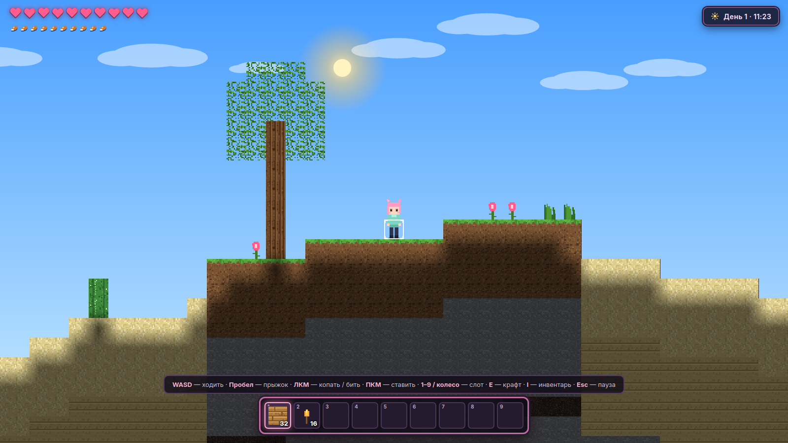
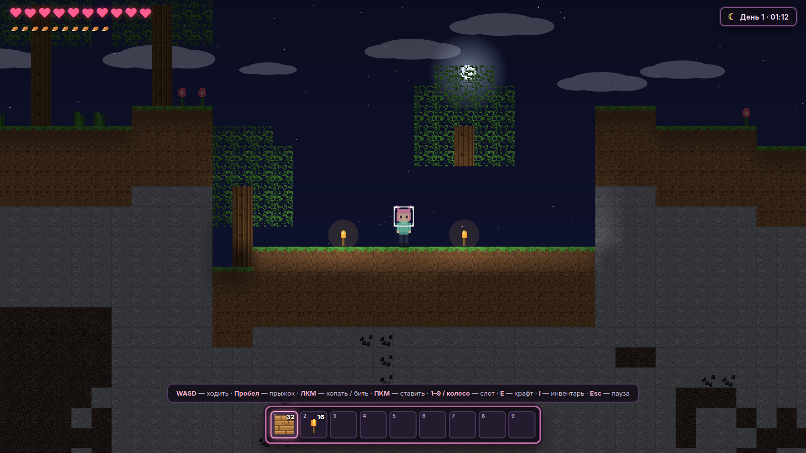
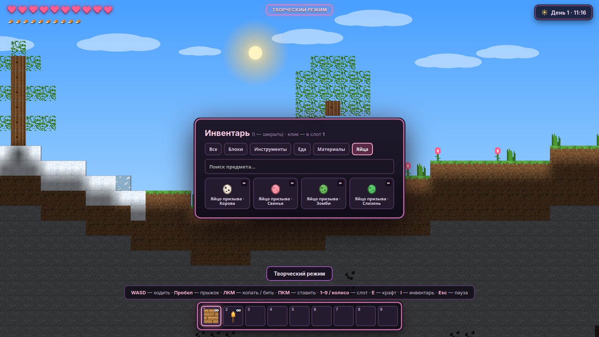
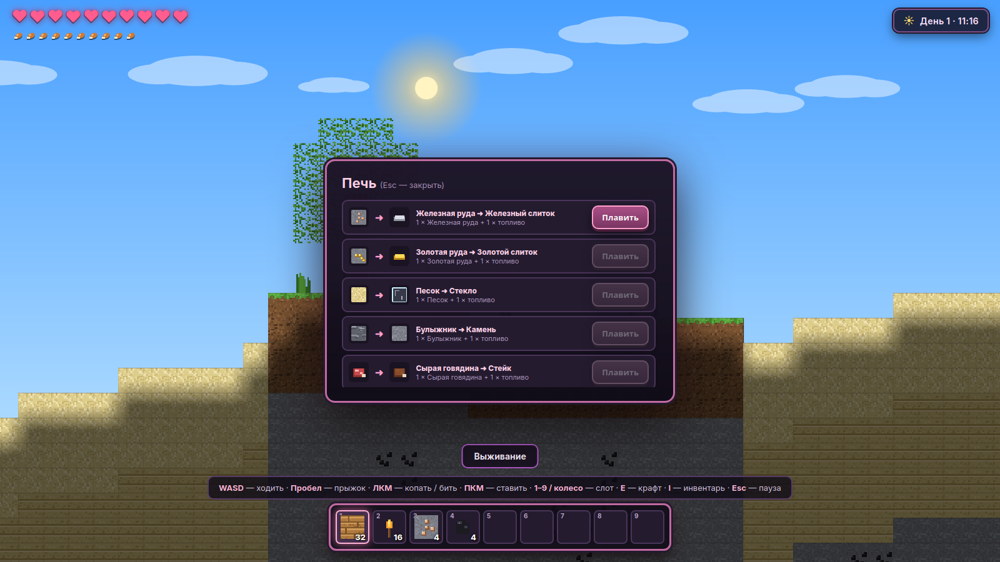
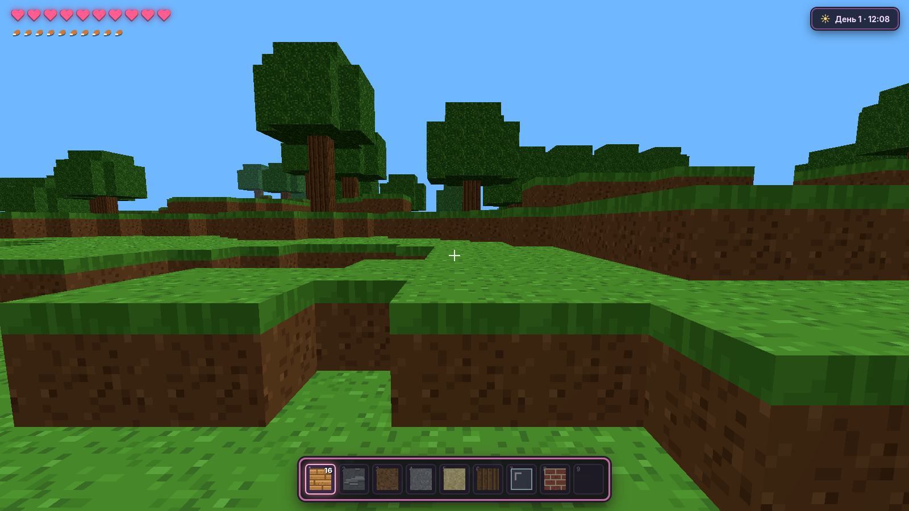

# AVIRBETA CRAFT

Независимая песочница **2D + 3D** в духе Minecraft — со своим брендом **AVIRBETA**.
Чистый HTML/Canvas/WebGL, без сборки и бэкенда.

> Проект не связан с Mojang или Microsoft. «Minecraft» и «Mojang» не используются
> как бренд проекта.

## Что внутри

### 2D-версия (корень)

- Процедурные миры 320×128: биомы (равнины, лес, пустыня, снег, горы),
  пещеры, руды, деревья, цветы.
- Копание с прогрессом, установка блоков, частицы.
- Инструменты (дерево/камень/железо/алмаз), прочность, скорость добычи.
- Крафт 3×3 с книгой рецептов, печь, сундуки.
- Голод, еда, здоровье, мобы (коровы, свиньи, зомби, слизни).
- День/ночь, освещение факелами, сохранение.
- Выживание и творчество (полёт, ∞ блоков, яйца призыва).

### 3D-версия (`3d/`)

- Настоящий воксельный мир от первого лица: 128×128, кубы 1×1.
- Процедурный ландшафт, деревья, пещеры, руды, вода, бедрок.
- Копание/строительство, хотбар, инвентарь, дропы.
- День/ночь, солнце/луна/звёзды, туман, освещение.
- Здоровье, голод, урон от падения, яблоки.
- Выживание и творчество: ∞ блоков, мгновенная добыча, полёт.
- Сохранение мира в localStorage.

## Запуск

```bash
cd minecraft-2d
python3 -m http.server 8080
```

- 2D: **http://127.0.0.1:8080/**
- 3D: **http://127.0.0.1:8080/3d/**

Важно использовать `127.0.0.1`, а не `localhost`: у браузера будут разные
хранилища, и сохранения не пересекутся с ожидаемыми.

Быстрый старт 2D без титульника: `/?play=1&fresh=1`
Быстрый старт 3D: `/3d/?play=1`

## Управление

### 2D

| Клавиша | Действие |
|---|---|
| A/D или ←/→ | движение |
| Пробел / W | прыжок, в воде — плыть |
| ЛКМ | копать / бить |
| ПКМ | ставить / открывать / есть |
| 1–9 / колесо | слот |
| E | верстак |
| I / Tab | инвентарь |
| Esc | пауза |

### 3D

| Клавиша | Действие |
|---|---|
| WASD | движение |
| Мышь | обзор (после захвата курсора) |
| Пробел | прыжок / плыть |
| Shift | бег; в творчестве — вниз |
| Двойной пробел в творчестве | полёт |
| ЛКМ | копать |
| ПКМ | ставить / есть |
| 1–9 / колесо | слот |
| E | инвентарь |
| Esc | пауза |

## Скриншоты







## Структура

```
index.html          — 2D-игра
game.js             — движок и контент 2D
style.css
3d/index.html       — 3D-игра
3d/game3d.js        — воксельный движок 3D
3d/style3d.css
3d/three.module.js  — Three.js r160 (MIT)
preview-*.png       — скриншоты
```

## Сохранения

- 2D: `localStorage["avirbeta_save_v2"]`, настройки `avirbeta_settings`
- 3D: `localStorage["avirbeta3d_save_v1"]`

Сохранения хранятся в браузере и не покидают устройство.

## Фон титульника

`bg.jpg` (обои) не входит в репозиторий из-за сторонних прав. Положите свою
картинку `bg.jpg` в корень проекта, если хотите фон; без неё титульник
показывается на тёмном градиенте.

## Лицензия

Код проекта — MIT (см. `LICENSE`).
Three.js — MIT, см. заголовок `3d/three.module.js`.

---

**AVIRBETA** · 2026
